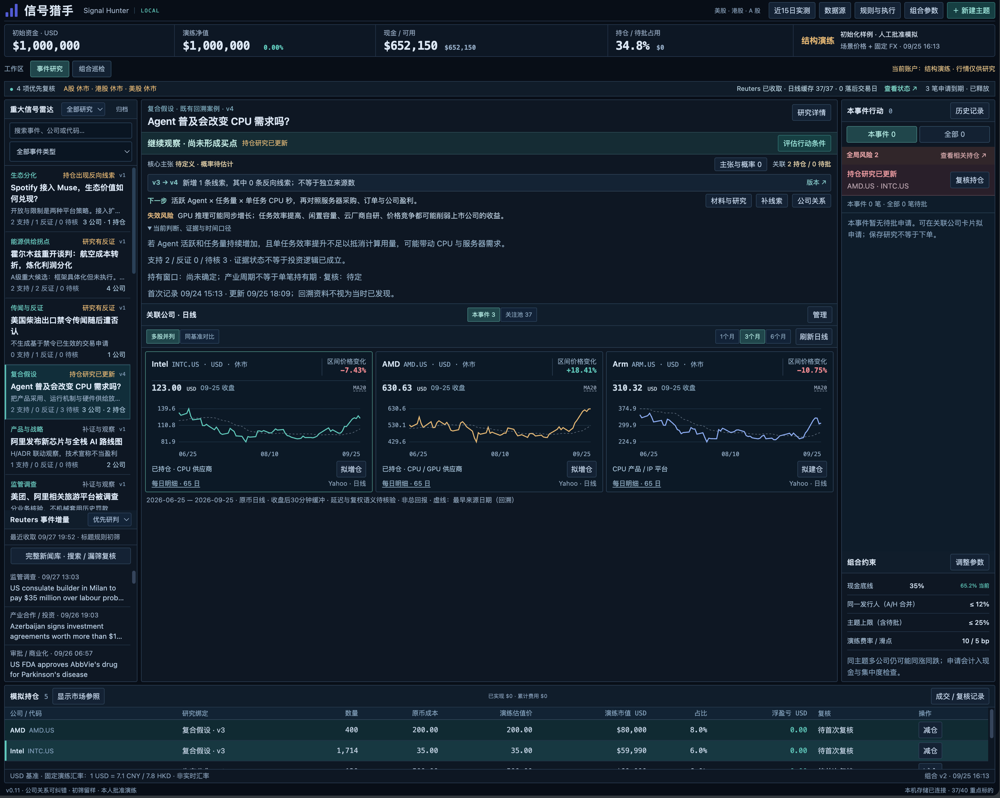
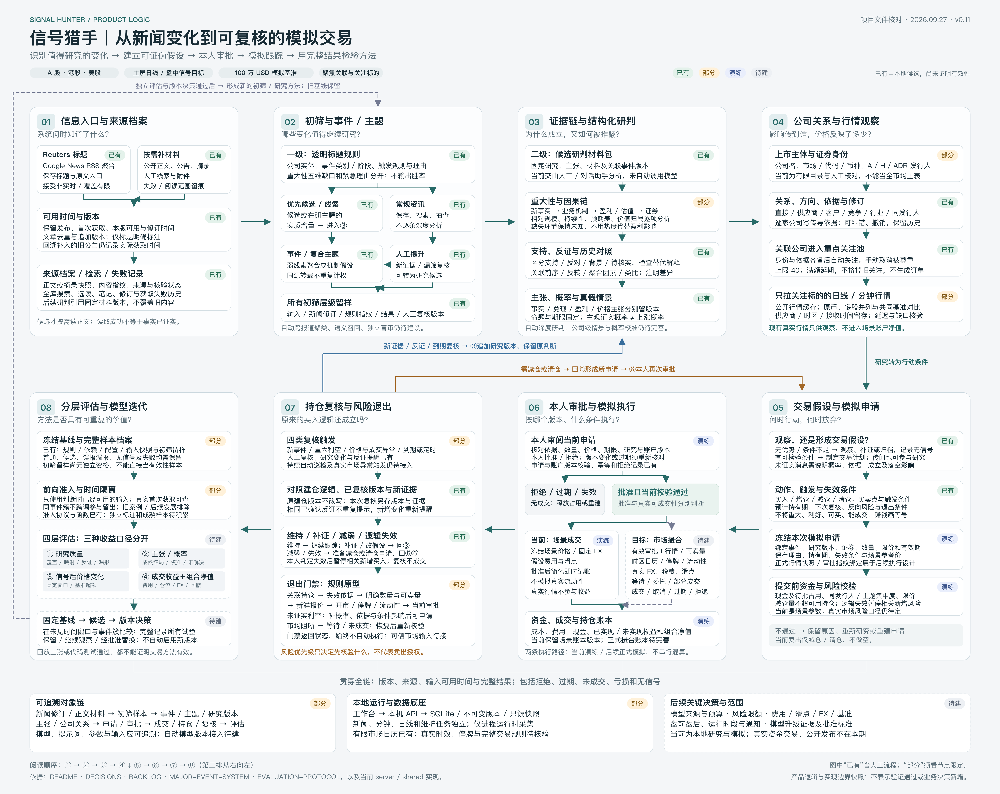

# 信号猎手 · Signal Hunter

**从新闻变化，到可复核的交易假设。**

信号猎手是一个本地运行的重大事件研究与模拟交易工作台。围绕 A 股、港股和美股，把新闻线索、证据与反证、关联公司、日线走势、模拟申请和持仓复核放在同一个研究上下文中。

它帮助研究者回答：**发生了什么？为什么可能重要？影响哪些公司？价格反映了多少？什么条件下行动，什么条件下放弃？**

**v1.0.0 · 正式版 · MIT · 本地单用户工具**

简体中文 · [English](README.en.md)

[快速开始](#快速开始) · [研究流程](#研究流程) · [能力边界](#当前能力) · [文档](#文档与开发) · [参与贡献](CONTRIBUTING.md)



*开发实例截图，展示已积累的研究、行情观察和场景持仓；这些内容不是默认安装数据，也不代表实际收益。公开包不包含该实例的数据库或原始新闻档案。首次启动载入独立的虚构演示。*

## 首版交付方式

按需手动发起研究批次，首页查看重大事件、判断与持仓风险；本人最终决定并确认成交记录。个人实例不配置定时任务或常驻研究任务；现有调度能力保留，启用需另行配置。组合默认进入原逐笔账本，可选择实际记录或手动模拟，分别核算并保留修订。手动模拟不证明市场可成交；无可靠现价时浮盈亏与回撤显示未知，已有买卖的已实现损益仍按确认记录核算。行情自动撮合后置，不要求购买行情服务才能使用首版记录流程。详见 [产品范围](docs/PRODUCT-BLUEPRINT.md)。

## 1.0 覆盖与限制

v1.0.0基于已合入主线的[RC候选](https://github.com/pafa/Signal-Hunter/pull/63)发布，沿用五区看板、自动研究及本人确认成交记录。源码版本不自动迁移个人数据；升级前须备份并固定原数据库入口。支持验证范围为本机macOS、Node 24.x的本地单用户运行；其他系统与干净物理主机未完成产品验收。

A股/港股研判质量、独立留出样本及长期效果明确为未验证，留待后续评估。美股也只完成指定公开开发材料的有限独立复核，不提供总体准确率或盈利保证。脚注公司线索与共享附件复用仍有两项覆盖缺口。当前协议已用冻结公开公告完成一次自动提取、身份、研判、系统保存与四类观察；这不是全市场或实时吞吐证明。

没有可靠现价时浮盈亏与回撤为未知；没有充分依据时买卖点、目标价与期限为未知。默认未配置的后台模型时限为7分钟，显式配置继续优先，失败按原有限重试记录。安装、恢复及版本证据见[任务清单](docs/BACKLOG.md)，实际使用与限制见[运行指南](docs/DEPLOYMENT.md)。

## 为什么做信号猎手

一条新闻不等于一个交易信号。真正值得研究的变化，可能是一次收购、一项监管决定、一种产品的持续增长，也可能来自多条弱线索的共同指向。影响还会沿供应商、客户、竞争者和产业链跨市场传导。

信号猎手把这个过程组织成可以追问、修订和复核的研究记录：

- **围绕事件组织信息。** 先筛选值得继续研究的变化，再把支持、反证与待核材料归入事件或复合主题。
- **把公司与事件放在一起看。** 记录关联类型、影响方向与依据，自动关注可识别的关联证券，并列查看多股日线或共同基准走势。
- **让不确定性可见。** 传闻和未证实消息可以参与研究；分别记录消息成真、业务兑现和价格变化的主张与概率。
- **让行动经过明确决定。** 本地候选可按一次配置的账户政策自动准备研究方案，核对条件、额度、报价、费用和期限后，由本人作最后一次模拟决定；手工申请仍保留。该闭环经过合成测试，真实研究质量与市场输入仍待验证。
- **持续检查原来的逻辑。** 新证据、反证和研究版本变化进入持仓复核。模拟持仓可按已核对的事件关系接续当前综合，保留原建仓版本与成本；新减仓或退出仍由本人最终决定。当前链路经过隔离合成验证，真实质量另行核验。

适合个人研究者、事件驱动策略探索者，以及希望搭建可追溯研究流程的开发者。当前界面主要为中文；这是早期研究工具，自动分析和有效性评估仍在建设中。

## 快速开始

需要 **Node.js 24.15+（24.x）** 和随 Node 提供的 npm。推荐版本见 [.nvmrc](.nvmrc)。首次安装依赖需要网络；默认演示运行不请求新闻、行情或模型服务。

下载并解压本仓库源码，在项目根目录打开终端：

```sh
cd prototype
npm ci --ignore-scripts
npm start
```

看到“工作台已就绪”后打开 [http://127.0.0.1:4178](http://127.0.0.1:4178/)。保持终端运行；按 **Ctrl+C** 同时停止网页和 API。

默认离线演示包含 **3 个虚构主题、9 个关联证券、合成日线、100 万 USD 场景账本、5 笔初始持仓和 3 笔待批申请**。证券代码用于演示三市场界面；事件和曲线均为合成内容。无需账户、API 密钥、模型服务或入金。

第一次可以这样体验：

1. 在左侧选择一个虚构主题，查看研究假设、支持与反证。
2. 在中间切换多股并列与同基准对比，查看关联公司的关系依据。
3. 切到“组合”，展开“高级：结构演练账本”，检查待批申请、资金占用与持仓；尝试批准或拒绝一笔演示申请。
4. 查看研究与模拟决定的版本记录，理解一项判断如何进入复核。

演示操作会保存在自己的演示库中，重启不会自动重置。在另一个终端的 `prototype` 目录运行 `npm run health`，可检查网页、API 与代理状态。端口冲突、备份和全新演示的处理见 [运行指南](prototype/README.md)。

## 本机稳定运行

新增生产静态入口、持久采集任务、暂停/恢复、来源能力状态与一致备份；见[本机生产运行与恢复](docs/DEPLOYMENT.md)。本机个人实例已启用Mac用户登录服务并验证崩溃恢复；实际验收范围及剩余事项见[任务清单](docs/BACKLOG.md)。默认安装仍需自行核对并启用服务，完整市场模拟与长期结果尚未验收。

## 开始自己的研究

最新开发候选增加了公司研究抽屉、关注表格与多股选择。点击公司可查看公司影响、直接引用的证据及场景持仓/申请；日期范围、比较组合和最近研究在当前浏览器会话中保留。原人工分析可继续补充。当前开发候选在自动研判中逐证券保存结构化公司判断，区分来源陈述、模型推断与缺口，附版本及原文引用；已对指定公开开发样本完成有限独立复核；A股/港股研判质量、独立留出及总体有效性仍未验证，不等于可执行的买卖方案。当前候选另保存[研究行动倾向与期限](docs/DEPLOYMENT.md#研究行动倾向与方案准备检查)，结合后台条件区分研究准备状态与账户方案；利好、触发与买入倾向分别表达，不新增中间审批。后续候选增加[同口径量级、敞口与预期差计算](docs/DEPLOYMENT.md#公司量级敞口与预期差)，逐值区分材料与假设，保留历史计算及公司编辑草稿；计算不等于事实核验或交易信号。

“设置 → 数据来源与关注证券”中的“新闻入口与覆盖记录”把广泛发现与关键词跟踪分开。可分别启停，并查看真实返回窗口、新增/修订、过滤与错误。两路来自同一聚合入口，不能作为两个独立证据源；达到100条时提示可能截断。官方入口包括默认关闭的美联储、香港金管局API/近期RSS、证监会和NVIDIA新闻稿；NVIDIA提供发布方直连，正文读取成功后才可进入自动研判，不代表全市场正文覆盖。金管局按日期补采、原始响应和逐页留档见[运行说明](docs/DEPLOYMENT.md#官方新闻与历史补采)。详见[任务进度与验证](docs/BACKLOG.md)。运行基础和研究导航已纳入1.0，具体启用状态以实例配置为准。

停止演示后，在 `prototype` 目录运行：

```sh
npm run start:research
```

这会使用**独立的空白研究库**，不导入演示主题、关注、持仓或订单。你可以“＋ 新建主题”，或从新闻建立研究草稿；初始保留 100 万 USD 场景现金，供模拟流程使用。

| 模式 | 启动命令 | 数据库，相对于项目根目录 | 数据来源 |
| --- | --- | --- | --- |
| 离线演示 | `npm start` | `data/runtime/demo.sqlite` | 原创合成示例；服务端外部数据请求关闭 |
| 自己的研究 | `npm run start:research` | `data/runtime/research.sqlite` | 在线新闻入口、重点公司的公开行情、按需材料 |

研究模式尝试通过 **Google News RSS 聚合 Reuters 标题入口**，并获取关注公司的公开行情；它不是 Reuters 官方授权 API，也不承诺实时、完整或持续可用。正文按需读取，数据保存在本机。页面中的来源状态和时间戳用于判断数据是否可用。

两种模式有数据库标记检查，阻止交叉打开已有库。兼容旧开发工作台的 `legacy` 模式、可调整端口和 `SIGNAL_DB_PATH` 见 [运行指南](prototype/README.md)。运行器读取进程环境变量，不自动加载 `.env`。

新候选补齐有依据的公司简称与存托凭证目录规则：Salesforce法定后缀可有界兼容，Cadence和SAP的已核对简称按准确目录名称及代码绑定；旧冻结身份输入仍按原规则回读。ADS候选与普通股分开留档，多证券、无精确名称和类型排除分别记录原因。已保存真实目录的离线核验通过，真实修复后的身份研判尚待接续。

后续候选可在材料身份识别面板按市场保存官方证券目录，支持美股、沪深 A 股和港交所中英文名单。原始响应及历史版本保留，未来日期快照只供查询并排除于当期模型召回；完整历史身份与北交所范围仍待补齐。见[目录范围与使用说明](docs/DEPLOYMENT.md#按市场保存官方证券目录)。

## 自动研究队列与手动批次

个人实例采用**按需手动触发批次 → 自动汇总分析 → 更新原看板 → 本人最终决定**。平时保持研究及采集任务暂停，不配置定时任务；需要时再明确发起处理。持仓复核保留数据时间、盈亏、风险与退出条件；不承诺实时抓取或未运行期间的持续监控。程序保留原周期调度能力，下面说明其启用后的行为，不表示当前个人实例已经启用。长期效果与后置事项不在本次发行中展开。

后续候选新增[未选标题的后台复核](docs/DEPLOYMENT.md#未选标题的后台复核)：新自动条目先读取并归档原正文，再分批判断是否深入研究，避免把只有常规标题的统计变化直接排除。入选沿原事项/公司链复用同一材料，观察项保存正文引用与缺口；原初筛与旧标题批次保持。读取和模型限次恢复，共用原调用额度，不增加日常人工提升步骤；重大性和买卖条件仍需后续证据。

配置本机 Codex 后，首页“启动自动研究”会同时启动新闻采集与研究任务，沿用已配置来源、筛选范围和滚动24小时调用额度。新入队材料依次保存正文、识别事项、识别公司并保存五章系统研判，不再要求逐项采纳中间结果。公司名称只能唯一对应冻结目录中的一个证券时才建立待核实关联，A/H/ADR 歧义与未知身份保留观察，研判继续。正文及模型失败最多尝试3次，失败记录与旧版本保留；用户取消、编辑或来源变化不会被自动覆盖。系统研判仍未核实，不创建、批准或执行交易。

新事项的标题、主体、动作、对象、阶段和边界说明会核对可解析的金额及比例：只使用本事项引文在完整来源中的数值和单位，原“$”不推定为美元。未支持的表达改为待核，后台继续研究；原模型输出、引文和旧版事项保留。同币种明确倍率可换算，其他位置的同额数字不作支持。此项只覆盖现有解析器支持的金额 / 比例写法，不代表会计语义、主体归属或模型自由文本已全面核实。

财务材料较多时，模型读取去重视图：重复的财务JSON改为指向同一正文中的完整事实行，数字索引按表格组织。原始材料包和来源正文保留，单位、期间、证据ID与引用校验保持；原输入与发送视图各有指纹。只有可准确重建的重复信息才转换，未知格式或不一致数据原样保留。

调用成功或失败时另保存阶段、耗时、输入输出字节和已观察到的事件数量，便于核对超时发生在哪一段；不保存推理文本、错误原文或尝试的工具内容。未收到完整用量仍标未知，诊断本身不代表研判时效已经达标。

新研判的模型输出将重复原文集中在引用表，各项判断使用短编号。保存前还原成现有完整引用并逐项核对；原模型JSON、输入与输出指纹继续留存。五章和公司分析、财务、监控、行动字段完整保留，旧研究不改写；减少重复字节不自动等于时效或质量通过。

自动事项及事件综合重试时，后台可从同一输入和配置的上次失败输出中核对财务数值引用错误，并把具体位置传给下一次完整研判。旧失败输出不改写，仍执行原校验、三次尝试、退避、暂停和滚动额度；不把诊断作为财务依据。模型在原推理时限内报告完成后，提前完成仍保留原调用窗口，临近截止补足5秒退出等待，仍须正常退出、取得完整输出并通过校验；这不证明真实完成时效已达标。

新生成包还将财务指标编号与文字字段的原保存要求直接发送给模型。旧任务遇到编号、重复项或字段长度错误时，后台可定位错误并按原材料重新生成完整研判；无需本人修改JSON。原输入、错误输出和重试上限保留，具体机制见[自动财务纠错](docs/DEPLOYMENT.md#自动财务引用纠错与cli收尾)。这只处理字段契约，不证明财务语义或买卖判断已经有效。

新包进一步核对[引用完整性与纠错留档](docs/DEPLOYMENT.md#引用完整性与纠错留档)：生成时明确引用表与实际引用的对应关系，后台失败反馈定位未用、缺失或重复编号等问题，再按原材料完整生成。旧结果及重试次数保持，新前向记录绑定实际纠错提示；仍需独立语义和真实运行验证。

新材料包另区分金额、每股金额与股数，可引用SEC的明确每股/股数单位；估值中的来源每股值不能借用普通同额金额。历史EPS不自动年化或当作未来预测；旧冻结包仍按原规则核对。见[每股财务值与股数的原文核对](docs/DEPLOYMENT.md#每股财务值与股数的原文核对)。

旧候选模式与旧队列保持原行为。自动条目现在可保存系统关系判断、建立首个事件簇并按完整配对扩展；未知和冲突保留观察。旧人工决定不覆盖，系统归组不等于事实已核实。来源修订后，新版全部事项完成研判并与保留成员比较，仅在对应唯一时自动延续原事件 ID，追加历史而不覆盖旧研究。已接续的旧研究收进同一事件的历史，首页区分当前与历史份数；查看旧判断有明确提示，可跳到对应当前研究，旧持仓风险仍保留。新版无具体事项或已由本人编辑会记录观察原因，其他材料继续。没有可用保留成员或同文档含多个旧事项时，先完整比较旧事项与新版候选，唯一一一对应后再核对新版全部成员。对应歧义或超出完整比较范围时保留观察。后台现在按同一事件的当前成员生成一份五章综合研判；成员、材料、来源新闻或配置变化后，旧结论转入历史，再追加新版。首页默认显示事件综合与当前证券合集，原研究可展开查看；综合详情提供冻结原文、公司分歧、条件缺口和历次调用，逐层返回保留版本与展开。

新增已收新闻补充检索：系统研判有缺口或原文读取失败时，自动寻找同一事项的相关线索，沿用正文、事项和研判队列；初筛未选中的自动条目可重新入队，原筛选与旧研究保留。补充材料逐项核对原事件，相关、未知和不相关分别记录，不能把读取成功当作缺口已核实。运行详情可展开检索范围、比较依据与历史，下钻返回保持上下文。范围暂限最近2000条已收新闻、90天内的线索和每次前三条候选；事件综合已纳入调用前留档与固定窗口报告，单篇 / 综合、失败及排除分别显示；原文明示网页与PDF链接也可有界补读；完整外部补证、大范围归组的真实时效和独立前向效果验证仍需补齐；全范围研究质量与成熟效果仍未验证；1.0的具体验收范围以任务清单为准。详见[运行说明](docs/DEPLOYMENT.md#自动发现与研判队列)及[任务进度](docs/BACKLOG.md)。

本地候选已将[通知与附件的文档关系](docs/DEPLOYMENT.md#通知附件与事件综合上下文)纳入已有事件簇的综合。已归档附件进入同版分析，未读入口逐项保留；原同事件歧义、来源范围和旧研究保持。原详情可展开核对父通知及附件，不增加中间审批。[单独事项附件续研](docs/DEPLOYMENT.md#附件补读后的自动再研判)也已形成候选：正文可用后后台追加原事项研判，并可继续选择其余重要附件；旧版本和未读范围保持。一次隔离真实接续已纳入4/4附件，但调用额度后仍有比较排队，具体证券影响和独立质量仍待验证。

自动任务已加入[事项阶段轮流推进](docs/DEPLOYMENT.md#事项识别公司身份与研判的轮流推进)：事项识别、公司身份和研判交替获得处理机会，避免多事项来源先占满整轮身份识别额度。保留原配置、重试、输入核对和最终模拟决定；具体完成时间仍取决于材料准备、模型和调用额度。

官方申报补证现可继续读取主申报中明确链接的同一申报目录HTML附件，每份主申报最多4份，不递归抓取或跨申报追踪。原件、父链接、实际获取时间和未读范围一并保留，后台失败沿用限次重试，最终带缺口继续。已验证4份真实公开附件的读取与归档；它们仍是待核背景，不证明与当前事件有关或已形成买卖建议。

新增[官方财务补证候选](docs/DEPLOYMENT.md#官方财务补证美国证券候选)：在自动研究配置中一次开启后，后续美国证券事项会在首次研判前自动读取 SEC 财务数据。程序选摘与完整原始响应、期间、单位和申报编号一起留存，失败限次后带缺口继续；原设置默认关闭。美股持仓的后续财报检查已接入同一后台，按6小时周期核对变化、追加新证据和研判，保留原记录；A 股 / 港股、分部、市场预期及真实持仓验收仍有缺口。它补充可核对输入，不直接证明估值或买卖建议有效。 同一后台步骤还按官方申报目录读取最近一期定期报告和较新的临时报告（最多两份HTML原件），保留整份原件，按固定财务词项向研判提供有限选段和完整表格块，并明确未读部分。 自动财务指标无需先填写人工量级表，历史背景可单列基准且不计算事件增量；数值引用回查完整材料，避免截断符号或区间。

官方财务读取已修复同一CIK下CORP/CORPORATION法定后缀差异被误拒的问题。财务、申报目录和明确附件保留两份原始名称及有界核对规则；不同公司仍拒绝，旧材料和耗尽任务不重写。该修复通过已保存Microsoft原件的离线核对，尚不等于真实后续研判或投资质量验收。

新增[自动研判价量输入](docs/DEPLOYMENT.md#自动研判的冻结价量材料)：新自动事项默认在首次研判前按已关联证券保存日线与分钟快照，原始响应、价格时点和实际获取时间同版留存；失败限次后带缺口继续。来源详情可展开范围、缺值与陈旧状态，新行情刷新不改旧研判，综合继承原依据。公开价量仍未证明实时或可成交，实际模型使用质量待验证；首页与导航保持原结构。

真实自动链路的后续核验另发现跨分钟收到的尾部最新成交点：现仅在供应商明确时间对应时将该即时点剔除，保留此前有效分钟柱，原始响应与已存材料不变。最新实测和剩余质量缺口统一见[任务清单](docs/BACKLOG.md)，不能以补齐价量输入代替买卖建议有效性验收。

## 事件追踪候选

自动事项研判会保存当次全部有效事项的召回范围，命中的候选每批3项自动续查；3项是单批大小，已启用自动模式不再只查前三项。正文准备、事项研判、比较、归组和综合轮流推进，滚动额度和暂停状态继续生效。运行详情分别显示已安排、待安排、已保存判断与保留缺口；范围固定于该次研判，新事项完成后继续补充比较。未命中仍不代表无关，真实识别质量需要独立验证。旧人工候选模式保持原限制，取消、人工改动和历史记录保留。

左侧“事件追踪”召回同一报道的重复、阶段差异、反向变化及相关研究，展示标题、原文入口、本版可用时间和匹配依据。可以保留关联、排除或撤销决定，再打开新闻继续研判。候选不自动改写研究证据或交易申请。

自动研究现默认在后台准备美股、沪深A股与港股官方目录，市场范围放在运行详情中一次设置。成功检查24小时内复用；失败限次退避，首次准备后缺口仍可随研究继续。每次新自动身份判断固定当时的目录快照，后台刷新不会改写旧依据。来源日期超前的目录留档但暂不参与识别；范围不含完整历史证券及北交所，目录不证明可交易性。目录恢复或相关身份依据变化后，仍为原系统保存版本的未知身份会自动追加核对；只有新增公司关联才继续补充证据并更新研判，原调用和旧判断不改写。无关目录刷新不重复消耗模型额度，人工编辑或排除不被自动覆盖；已读明确附件现在会自动追加主体核对：同时保存附件引用、原事项引用及关联理由，只有直接关联且名称在冻结目录中唯一对应的公司才接入原事项研究。背景提及、多证券歧义和未知母子公司关系继续留档；真实模型识别质量仍待核验。 目录状态与名称召回现在复用未变化数据库上的完整性校验结果，修改、其他连接提交、事务与日期变化会重新核对；同一真实批次副本的状态读取已提速，完整研究吞吐仍待验证。 已核验材料也可在数据库未变化时复用，避免每次看板刷新重复解析同一申报HTML；原件损坏、修订和事务边界仍重新检查。

公开网页现将已识别发布方正文区的明确附件入口保留到补读材料中，包括美联储公告独立附件区；已识别证监会/金管局页面沿用各自正文范围。未知或歧义布局仅扫描提取正文。入口最多30项且披露截断，每次研判最多选择3个；新补读链最多两层，可从新闻接到通知，再接到附件。仅同主机原文明示HTTP链接可保留原地址并升级为HTTPS读取，失败不回退HTTP。回链、第三层及未选附件保留缺口；附件链接仍不是已读事实，读取结果另存不可变材料。旧版材料保持可读，旧记录不补造附件。 新的公开读取会把原请求、跳转后的地址及材料版本一并留档；明确附件可按该记录自动回接原事项。无读取记录的旧跳转不猜测对应关系，普通引用网页仍须独立研究与事项比较。

公开PDF可自动读取文字层，并按页保留文字、无文字页和原文件指纹，进入原有研究 / 归组 / 综合流程。读取失败保留缺口且不阻断其他新闻。文字层不能证明表格列、扫描图或附件已读完整；文件元数据不作为发布日期。原件只存本机并随数据库备份，不包含在源码发布包中。详见[PDF读取范围](docs/DEPLOYMENT.md#pdf来源文字层)。

开发候选新增“Codex 语义比较”：每侧可选择新闻标题或研究中已保存的材料，比较主体、动作、对象和阶段。正文沿用不可变材料快照，标明摘录、人工文本或网页提取范围；引用须逐字来自对应侧标题或正文。使用与五章研判相同的本机 Codex 配置，保留输入、模型结果和本人采纳/撤销历史；新闻或材料修订后旧候选不可继续采纳。此手动入口不会自动抓取全文或合并研究；系统自动归组见上文，其真实语义质量仍待独立验证。 新候选把事件时间与引用依据绑定：明确日期保留原文，相对时间单列且不自动换算成确定日期，缺证据记为未知；旧比较显示未记录时间依据并保留原结果。

手动模式的“持久比较批次”可先选择2至10份新闻或已存材料，预览全部配对和调用次数，再逐项调用本机Codex。队列、暂停、失败及历次尝试保存在当前数据库；首次调度默认暂停，失败需本人明确重试。自动模式的新输入按上文自动队列处理，不要求逐批手动操作。

自动归组和来源修订不再受手动十份输入上限限制：冻结全部成员与配对，复用当前仍有效的比较，只逐项调用缺失部分。额度耗尽保留队列，恢复额度或重启后继续；全部比较一致前保留原事件。旧版仅因自动比较数量上限停止的记录，可追加一次新计划，原停止记录不覆盖。完整配对仍随成员数平方增长，召回范围、综合材料包容量和大规模性能各自受限，解除数量门槛不表示已验收千篇吞吐或真实分析质量。 后续性能候选减少同一事件簇内容的重复校验，进度汇总不再重复展开每一对原文；事务内仍实时检查归属和输入。当前测量仅覆盖合成接续流程，不代表真实模型或千篇处理时效。

批次中的“核对事件簇”逐对检查同事件候选，存在三角冲突、失效或缺口时阻止归组。本人确认后保存稳定事件簇ID和成员历史；后续输入/决定变化提示复核，原记录保留。研究详情可查看证据所属簇。这是有限范围的归组候选，不代表全库聚类、实体消歧或独立来源已核实。

“研究详情 → 关联事件”会按精确证据版本，从有效的已采纳比较中召回相关研究。本人保存关系时可冻结比较依据，明确左右方向和引用；撤销比较或修订材料后，原研究关系保留并提示依据需复核。相同材料出现在多份研究中不增加独立证据数，关系也不沿链条自动推导。

复核优先级参考持仓、风险线索与既有研究；它不是重大性或上涨概率。来源家族不等于独立取证。索引范围、失败状态和版本留在界面中；完整语义识别和样本外准确率评估尚未完成。

## 实际持仓记录候选

研究模式在原“组合 → 实际持仓记录”保留快照，并新增逐笔账本。本人明确期初现金、全部期初持仓及成本方法后，可以录入或预览导入买卖、费用、出入金、现金股息、拆并股和对账记录；同账户币种改按账本重算，旧快照只作历史，不重复计入持仓。修正使用原编号的下一修订，保留原版；重复请求不重复记账。按账单所列成本或本人选择的移动平均研究口径计算数量、剩余成本、已实现损益及账面现金，缺费用、成本或金额时相应结果未知。

首页继续使用原账户下拉、持仓行与详情：数量和成本来自账本，参考估值只使用原私有桥接中合格的当前标记价；没有报价不借用原快照价。当前净值和扣除净入金的期间损益只有资料完整时才计算，账面现金不等于已结算可用资金。后台候选现可保存原币净值采样，按出入金发生时间计算近似参考收益及采样回撤；首页显示今日首个有效采样以来的变化，完整路径与资金流在原账户详情展开。无两个有效采样、缺价、暂停或修订后等待更新时，当前指标继续未知。后台实际持仓巡检可按已核对的事件关系接续当前综合，保留原记录关联版本与成本；退出、失效和复核条件进入同版研究提示，不生成实际卖出数量或限价。关联歧义、来源失效和过期状态明确保留。此链路只经隔离合成验证；参考收益不是精确时间加权收益或券商收益，采样回撤不代表未记录的盘中最大回撤。净值候选采用增量计算及分段计算状态，避免每次看板读取全量历史；10万点纯现金账户的隔离压力对照已完成。真实输入、账户核验、多持仓 / 多账户长期负载与持续运行仍待验证。本候选不连接券商、不下单，也未与券商同步。见[快照规则](docs/DEPLOYMENT.md#实际持仓快照)、[逐笔账本规则](docs/DEPLOYMENT.md#实际逐笔账本)及[净值采样口径](docs/DEPLOYMENT.md#实际净值采样与参考收益)。

## 双策略市场模拟候选

开发候选增加两个各 50 万 USD 的独立模拟池：激进热点追板与稳健长期研究。参数、退出复核、审批、部分成交及版本账本见[双策略说明](docs/MARKET-SIMULATION.md)。当前只有合成执行输入验收，未接通真实可成交报价；现有场景账本保持独立。

已有策略触发止损、跟踪回撤或持有期限复核时，系统可自动整理触发批次的可卖数量、限价、费用和有效期，进入首页原“买卖待决定”；本人查看依据后选择批准模拟退出或暂不退出，无需重填卖出表单。休市、不可卖、输入不足、研究变化或已有卖单时保留原因；批准仍等待之后的新报价，可能部分成交或未成交。该候选限价来自已配置滑点与当前报价，不是目标价预测，也不对实际持仓执行交易。见[自动退出候选](docs/DEPLOYMENT.md#模拟持仓自动退出候选)。

## 研究评估候选

开发候选提供“研究评估”：冻结整批初筛样本，先人工标注再揭示规则统计，保存事件簇、信息不足、已见结果情况和标签版本。概率评分区分首次与结局登记前修订，报告可导出复核。当前是回溯诊断，不能证明前向预测或策略有效；详见[评估协议](docs/EVALUATION-PROTOCOL.md)。

## 工作台布局

主导航为“工作台 / 组合 / 评估”。工作台沿用深色三栏：顶部显示整体状态；左侧看事件与变化，中间看研判与行情，右侧看全局风险、买卖待决定和后续监控；下方常驻持仓与退出摘要。首页按依据仍有效的事项归组显示一条事件摘要，展开查看各份研究、来源与本次变化；没有明确事项身份或依据失效时仍单独显示，原研究不合并改写。首页显示重点与总数，“查看更多”承接完整列表，保留选中研究与展开状态。选择事件只高亮关联持仓，不隐藏其他持仓风险。激进、稳健市场模拟与结构演练分别查看和核算，未知估值不会显示为零。

进度和技术待办从“后台进展”进入运行详情，日志可按研究或异常筛选，原记录保留。阅读、展开与账户切换不发起任务或批准买卖；详情逐层返回保留研究和持仓上下文。首页“启动自动研究”启用系统续跑，“运行详情”查看队列和预算；自动归组、综合研判和已收新闻补充检索已形成候选，完整外部补证与条件方案仍待补齐，见[产品设计基线与 1.0 路线](docs/PRODUCT-BLUEPRINT.md)。

研究详情归为摘要、证据、公司与行情、行动、历史五组。结构演练账本和分钟行情放在高级展开项；来源、任务、预算和备份在设置中。旧 `classic/demo/research-v4` 页面链接保留主题与时间范围，转到统一工作台；运行模式仍由启动配置决定。当前候选的验证与部署状态以 [任务清单](docs/BACKLOG.md) 为准。

## 研究流程

**信息入口 → 事件与主题 → 证据研判 → 公司与行情 → 模拟申请 → 本人审批 → 持仓复核 → 分层评估**

| 环节 | 核心问题 | 当前产物 |
| --- | --- | --- |
| 信息入口与初筛 | 系统何时知道这件事？值得继续研究吗？ | 来源、首次获取时间、新闻修订与标题规则初筛样本 |
| 事件与结构化研判 | 哪些材料支持判断？什么证据会推翻它？ | 事件或复合主题、证据/反证、主张与概率、研究版本 |
| 公司关系与行情 | 影响传到谁？价格已反映多少？ | 关系依据与修订、重点关注池、多股日线与对比 |
| 交易假设与申请 | 何时行动、持有多久、何时失效？ | 触发与失效条件、预计持有期、数量/限价/有效期、风险检查 |
| 本人审批与模拟 | 是否接受这个版本和条件？ | 批准/拒绝/过期记录、场景成交、资金与持仓账本 |
| 持仓复核与评估 | 原逻辑还成立吗？方法是否有价值？ | 复核记录与新申请；分层评估协议，完整自动评估仍待建设 |

### 产品逻辑图



[查看原尺寸逻辑图](docs/assets/product-logic.png)。图中分别标出**已有、部分、演练、待建**，描述的是实现范围，不是交易效果验证。两张图片的背景与使用范围见 [图片说明](docs/assets/README.md)。

## 当前能力

| 已可使用 | 当前边界 |
| --- | --- |
| 标题规则初筛、新闻检索、漏筛人工复核 | 已有有界语义比较与完整配对自动归组；识别准确率及全市场覆盖尚未验证 |
| 版本化证据、材料、研究、主张与反证 | 研究实例可配置本机 Codex 生成候选，须本人复核；离线演示不调用模型 |
| A 股 / 港股 / 美股公司关系与自动关注 | 使用有限公司目录；身份、业务敞口及跨市场映射仍需核对 |
| 多股日线并列、共同基准对比、分钟数据观察 | 免费来源可能延迟或缺失；复权、日历和供应商差异需核验 |
| 模拟申请、本人决定、风险检查和持仓复核 | 使用冻结场景价格、固定 FX 和简化费用；市场行情不进入账本净值 |
| 输入留样、版本追踪和评估协议 | 独立样本统计、概率校准和策略收益验证尚未完成 |

当前模拟成交用于演练流程，不覆盖真实流动性、部分成交、T+1、涨跌停或完整税费。**没有券商下单接口；测试通过、截图和回溯案例都不构成盈利或策略有效性的证明。**

这是本地单用户工具，网页与 API 默认监听 `127.0.0.1`。模拟审批是工作流操作，不是身份认证；请勿直接将端口公开。详见 [安全说明](SECURITY.md) 与 [数据政策](docs/DATA-POLICY.md)。

## 文档与开发

工作台使用 **React + Vite**，本机 API 使用 **Node.js HTTP + 内置 SQLite**。网页经同源 `/api` 代理访问服务，输入、研究与模拟决定保存版本。无需另外安装数据库服务。

| 文档 | 内容 |
| --- | --- |
| [运行与故障排查](prototype/README.md) | 命令、端口、运行模式、备份与常见故障 |
| [架构](docs/ARCHITECTURE.md) | 模块职责、数据流与实现边界 |
| [规则设计](docs/MAJOR-EVENT-SYSTEM.md) | 重大性、传导、申请、复核与退出规则 |
| [评估协议](docs/EVALUATION-PROTOCOL.md) | 可用时间、事件隔离、基线与样本外评估 |
| [任务清单](docs/BACKLOG.md) / [决策记录](docs/DECISIONS.md) | 唯一进度源与关键决定 |
| [变更记录](CHANGELOG.md) | 版本范围与发布说明 |
| [贡献指南](CONTRIBUTING.md) | 开发、测试和提交要求 |
| [源码发布](docs/OPEN-SOURCE.md) | 可审阅导出、校验清单与发布步骤 |

在 `prototype` 目录进行开发检查：

```sh
npm test
npm run build
npm run release:check
```

下一步优先完善公司级影响与替代解释、重大事件识别评估、持仓风险复核，以及真实市场约束下的模拟执行。各项进度和依赖以 [任务清单](docs/BACKLOG.md) 为准。欢迎用可复现问题、合成样例和小范围 PR 参与。

## 许可证

原创软件与文档采用 [MIT License](LICENSE)，版权署名为 Signal Hunter contributors。第三方新闻、行情、商标和依赖保留各自权利；MIT 不自动授予这些内容的再分发权限。详见 [第三方声明](THIRD_PARTY_NOTICES.md) 和 [数据政策](docs/DATA-POLICY.md)。
